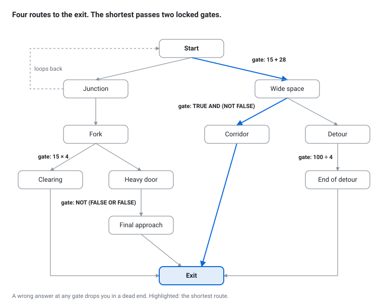

# What LabyrinthBench is

An agent's work is a path through context: every turn, what goes into the model's context decides which branch it takes, and most branches end in failure long before the goal. LabyrinthBench measures those paths in a world simple enough that we always know the right answer, so a policy for managing context can be scored exactly, with no judge.

## A labyrinth you can draw

The First Labyrinth is the whole idea at its smallest. Rooms are joined by paths. Some paths are blocked by a locked gate that opens only for the correct answer to a simple question. One path loops back to where you started. A wrong answer sends you to a dead end.

<figure>
  
  <figcaption>The First Labyrinth · 11 rooms, 5 locked gates, 1 loop</figcaption>
</figure>

The model never sees this map. It sees one room at a time, described in words, and has to find its way out.

## How a run works

The model sees the labyrinth as a text-based game, one turn at a time. Each turn it reads where it is and picks one of four moves:

1. **Look**: describe this room again: its paths, and the question on any locked gate. Looking is free.
2. **Walk**: take an open path to the next room. Every move through a path costs one step.
3. **Answer**: give an answer to a locked gate. Correct answers open it. Wrong answers send you to a dead end, or in some mazes, cost one of a limited number of "lives".
4. **Note**: write yourself a line, and the engine shows it back in every later look. Notes are free. Models rarely use them. In the campaigns behind the write-up linked below, notes appeared in 4 of 24 runs that kept their history and in none of the 24 wiped runs that had a record of answers. Without that record, 3 of 6 runs wrote notes, and every value they recorded for the first gate was wrong.

A run ends at the exit, when the lives run out, or when the movement budget is exceeded. The score is how far the model got: the exit, or the number of gates it passed.

Every answer is an exact string checked by the engine. There is no AI judge, and every run is logged so it can be replayed for verification.

## The labyrinth that matters is the context

I set out to map the contextual dependencies that lead from a query to a goal. My first version did it the wrong way: it put models in a maze and ranked them. The maze was never the interesting labyrinth.

The interesting one is the maze of contextual dependencies. Every decision made leads the model to a new set of branching possibilities. But what is the best approach to retaining the context of previous decisions? Should the model retain: all of its history, a short record of what it has already solved, nothing at all, or some other nuanced strategy? By keeping the model and maze the same, we can measure the effectiveness of different context management strategies. This tree represents the path taken from the start of the run to the end. Most branches end in a failure to reach the exit due to repeated wrong answers, forgotten values from previous gates, or non-progressing navigation looping.

Here is the same moment, on the Recall Ladder (the first maze in the table below), under three of the context strategies above. The model has just answered the first gate correctly (its answer was 7). Gates carry short labels, and the first one is c1a. The next gate says "Add 5 to your c1a answer." The model and the maze are the same each time. Only what the model reads next changes.

**What the engine sends back.** After every move the engine returns a short status: whether the answer was right, where the model is now, which gate it faces, and how many steps it has used. It names the next gate but not its question. After the correct answer at gate 1 it sends:

```
--- OK ---
Gate answer: CORRECT
Location: n1
Gate 2.
Steps: 1 / 60
```

Each strategy decides what the model reads on its next turn. The contexts below are in the harness's own format, and ⟨…⟩ marks text left out.

**1. All of its history.** The engine's reply is appended to everything before it. The model reads:

```
[system]  ⟨the rules of the game⟩
[engine]  ⟨the first look: room start, the map, gate c1a and its question⟩
[model]   {"action": "commit", "path_id": "forward", "answer": "7"}
[engine]  --- OK ---
          Gate answer: CORRECT
          Location: n1
          Gate 2.
          Steps: 1 / 60
```

The new question is not in it. The model has to look, then find its first answer, 7, somewhere in its own growing transcript.

**2. A short record of what it has solved.** The history is dropped. After every move the harness looks for the model, and the engine puts the answers it has recorded at the top of the view. The model reads two messages, the rules and this:

```
[system]  ⟨the rules of the game⟩
[engine]  [MAP — fog of war: corridors shown ~2 hops out; room interiors
          (text + gate problems) stay hidden until you enter a room]
          ⟨the corridors within two rooms of n1⟩

          [RECALL — gate answers you have recorded] c1a = 7

          --- OBSERVE ---
          Location: n1

          Gate 2.

          Steps: 1 / 60

          Paths:
            forward: gate  [GATE c1b: Add 5 to your c1a answer]
            back: return to previous location  [open]

          Objective: reach EXIT.
```

Everything the gate needs is on the page: 7 + 5 = 12.

**3. Nothing at all.** The history is dropped and the harness keeps no record:

```
[system]  ⟨the rules of the game⟩
[engine]  [MAP — fog of war: corridors shown ~2 hops out; room interiors
          (text + gate problems) stay hidden until you enter a room]
          ⟨the corridors within two rooms of n1⟩

          --- OBSERVE ---
          Location: n1

          Gate 2.

          Steps: 1 / 60

          Paths:
            forward: gate  [GATE c1b: Add 5 to your c1a answer]
            back: return to previous location  [open]

          Objective: reach EXIT.
```

The question names c1a, but nothing says what it was. Looking again only repeats the question. The 7 is gone.

Same model, same maze, same moment. On the Recall Ladder below, a 14B model under strategy 1 stops at a median of three to five gates. Under strategy 2 it reaches the exit in five of six runs. No single part of the switch does it: adding the record of answers to strategy 1 did nothing, adding the fresh look at the current gate to strategy 1 did nothing, and strategy 2 missing either one reached the exit in 1 of 23 runs. The full account, with every arm named by its parts, is [the write-up in the data annex](https://labyrinthbench.ai/data/mcv/).

## Three instruments

The First Labyrinth shows the machinery. The working mazes strip out the walking so that one thing at a time decides how far a run gets.

| Maze | What it is | What it tests |
| --- | --- | --- |
| Recall Ladder | 20 gates in a straight corridor. Each question builds on earlier answers ("add 5 to your c1a answer"), and later ones multiply. Four wrong answers end the run. | Can the model carry forward what it has already earned, and compute with it? |
| Changing Answers | 34 gates. Values change during the run, several share the same value, and the same question can come back with a different right answer. Five wrong answers end the run. | Does the model update, or repeat what used to be true? |
| Positive Control | 7 gates, each a hard multi-digit multiplication, labelled ALPHA to GOLF. | Can the benchmark see memory at all? Unaided, the model makes mistakes. Handed a perfect answer key in its memory, it should pass all seven. If it does not, nothing else here about memory counts. |

## What it measures, and what it does not

**It measures** how far a fixed model gets under a given context rule, on mazes where every answer can be checked exactly. It also records what each rule costs (the size of the context, turn by turn) and where each run failed, so failures can be traced.

**It does not:**

- Search the whole tree. A run takes only one path. To compare branches, I replay a run from a chosen turn under different rules. That's still a handful of branches, not all of them.
- Rank models. The first version did, and 5 of the 17 models on its board now reach the top of the Recall Ladder. The question here is which context management strategy gets a given model further through the maze.
- Prove anything about real work. Most gates are arithmetic. Whether a context strategy that wins here also wins on real tasks is still an open question, but one that I hope to answer with later mazes.
